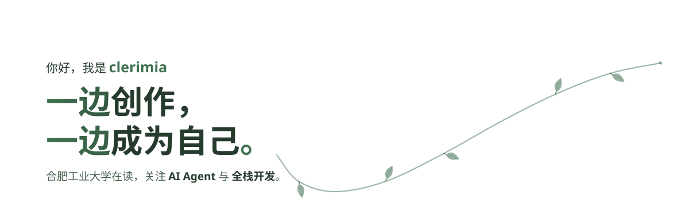

<picture>
  <source media="(prefers-color-scheme: dark)" srcset="./assets/hero-dark.svg">
  
</picture>

  <picture>
    <source media="(prefers-color-scheme: dark)" srcset="./assets/divider-dark.svg">
    
  </picture>

### 最近在做什么

- 折腾一个能通过日常聊天软件交流的个人 AI Agent
- 在[博客](https://clerimia.github.io/)里写技术文章，也写阅读时的困惑、面试后的感受
- 不写代码的时候，看小说、动漫，听日轻，偶尔打英雄联盟、我的世界、鸣潮

### 在用的工具

**语言** &emsp;&nbsp;&nbsp;&nbsp; 
**设计** &emsp;&nbsp;&nbsp;&nbsp; 
**前端** &emsp;&nbsp;&nbsp; 
**后端** &emsp;&nbsp; 
**数据库** &emsp;&nbsp; 
**AI 工具** &emsp;&nbsp;&nbsp;&nbsp;&nbsp;&nbsp;&nbsp; 
**环境** &emsp;&nbsp;&nbsp;

### 找到我

  <a href="https://github.com/clerimia">GitHub</a> ·
  <a href="https://clerimia.github.io/">博客</a> ·
  <a href="https://clerimia.github.io/rss.xml">RSS</a> ·
  <a href="mailto:1525258693@qq.com">1525258693@qq.com</a>

  <picture>
    <source media="(prefers-color-scheme: dark)" srcset="./assets/outro-dark.svg">
    
  </picture>

